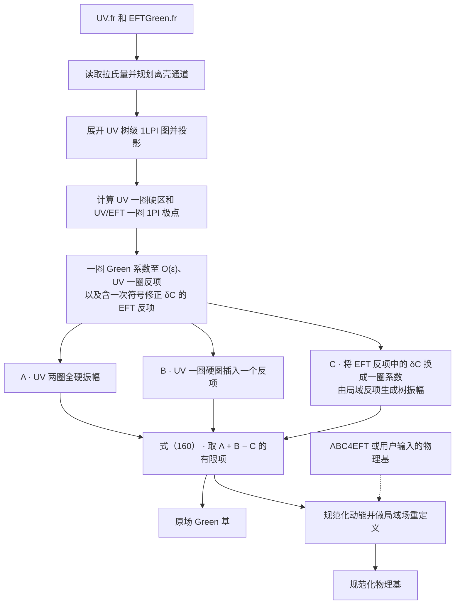

# 附录　FeAmMatch2 的图解两圈匹配实现

## A.1　输入与约定

程序读取独立的 UV 拉氏量和 EFT Green 基拉氏量。输入文件提供显式实标量、质量、重轻场标记及各局域算符的归一化，EFT 文件另列出独立待定 Wilson 系数。计算沿用论文的 Minkowski 度规、$d=4-2\epsilon$ 和 MSbar 测度。展开参数 $h=1/(16\pi^2)$ 用于记录总圈阶。本文的两个标量算例均保留非零参考轻质量，按单重阈值和有序形式维六截断。

由 EFT 算符对外场求变分得到离壳顶点响应。程序由这些响应构造外腿通道和独立动量结构，并据 UV 顶点与总圈阶规划图生成阶数。输入 Green 基需要覆盖相应算符，程序在生成的通道内检查投影秩和全部动量方程。

计算顺序及两圈输入的来源如下。

## A.2　树级和一圈

FeynRules 按任务导出 UFO。FeAmGen 与 QGRAF 生成图，Python 辅助按内线切断条件选取 UV 1LPI 或 UV/EFT 1PI 图。1LPI 匹配保留重场桥，并排除轻场桥。树级对重传播子作局域 Taylor 展开，再以 EFT 局域顶点响应投影，得到 $C_G^{(0)}$。

一圈 UV 1LPI 图计算硬区振幅。UV 与 EFT 的局域反项来自各自的一圈 1PI 图。提取局域极点时在传播子中保留参考质量，对外动量展开。UV 反项在匹配通道生成树振幅，EFT 一圈反项使用树级 $C_G^{(0)}$。三者按照论文式（53）在 $d$ 维组装如下。

$$
 M^{\rm tree}_{\rm EFT}[C_G^{(1)}(\epsilon)] =
 M^{\rm hard}_{\rm UV,1}
 + \delta M^{\rm tree}_{\rm UV,1}
 - \delta M^{\rm tree}_{\rm EFT,1}[C_G^{(0)}].
$$

共同的总圈因子在式中省略。程序保留 $C_G^{(1)}(\epsilon)=F+\epsilon E+O(\epsilon^2)$，并保存 UV 一圈反项。为得到 EFT 一圈反项随 Wilson 系数的变化，程序另外生成恰好含一个符号修正 $\delta C$ 的 EFT 一圈 1PI 图，从极点构造对 $\delta C$ 线性的局域反项。符号修正覆盖所需的相互作用顶点与二次插入。

## A.3　式（160）的三项

设 $A$ 为 UV 原始两圈 1LPI 图的全硬振幅，$B$ 为恰好含一个 UV 一圈反项的 UV 一圈 1LPI 硬区振幅，$C$ 为 EFT 一圈反项在一次匹配系数修正后给出的局域树振幅。FORM 处理硬区 Taylor 展开和部分分式，OPITeR 处理张量约化，sunset FORM 头文件处理真空积分 IBP。维数依赖在积分约化中保持精确。

$B$ 中的一圈积分需要保留到 $O(\epsilon)$，以乘上 UV 反项的 $1/\epsilon$。$C$ 则把所存局域反项中的 $\delta C$ 换成 $C_G^{(1)}(\epsilon)$，再由该局域拉氏量求树顶点；其中 $\epsilon E$ 与极点相乘产生有限项。按同一离壳通道组合后得到

$$
 M^{\rm tree}_{\rm EFT}[C_G^{(2)}]
 = \left[A+B-C\right]_{\epsilon^0}.
$$

物理基转换以最终轻尺度截断前的 Green 系数为输入，依次做有限动能规范化和局域场重定义。保留到总两圈阶的低圈乘积，并分别截断原场 Green 基和物理基输出。ABC4EFT 可提供目标物理基，用户也可显式给出目标拉氏量。

## A.4　可复现算例与验证口径

`example1` 使用含重轻三次耦合的论文模型及 MSbar tadpole 约定。核对文献中的六个 Green 系数、三个物理系数，以及式（190）给出的一圈匹配系数的 $O(\epsilon)$ 项。`example2` 消除重场 tadpole，并把重场三次耦合 $k$ 计为软参数。物理基的质量平方、四次和六次系数可与 [arXiv:2311.13630v2 式（34）](https://arxiv.org/html/2311.13630v2#S3.SS2) 对照。

完整运行的 `eq160-contributions.wl` 保存三个 Laurent 振幅。程序检查式（159）的 UV 树反项是否只含极点。沿匹配轨迹推断的 EFT 整体两圈反项可用于组装核对，扣除后得到的零余项是构造关系。独立极点证据来自双极点递推和双对数 RG 检查。当前版本的运行及对照状态见[验证记录](VALIDATION.md)。
