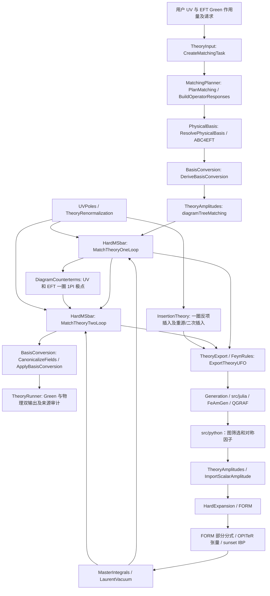

# 单流程架构

圈阶为 0 或 1 时在相应阶段进入物理转换，仍是同一调度入口。图中的反馈表示组装调用关系，不是迭代求固定点。

## 模块职责

| 模块 | 核心函数与职责 |
|---|---|
| TheoryInput、OperatorResponse | 输入、维数、独立系数、动量响应与精确线性系统 |
| MatchingPlanner | 从实际顶点和响应生成通道、顶点阶及 Taylor 预算 |
| ScalarJetAlgebra、AuxiliaryGreen | 局域导数代数、重场经典 EOM 和维八辅助候选 |
| TheoryAmplitudes、TheoryExport、Generation、src/julia | UFO 校验、FeAmGen/QGRAF 适配、1PI 与 1LPI 图生成及导入 |
| src/python | 标准库文件、UFO AST、图筛选与精确有理对称权重；无积分或匹配系数实现 |
| HardExpansion、Precision、VacuumReduction、MasterIntegrals | FORM 硬展开、精度传播、OPITeR、IBP、主积分与 Laurent 组合 |
| UVPoles、TheoryRenormalization、InsertionTheory | 整体极点审计、反项作用量、实际单反项插入图 |
| DiagramCounterterms | 完整 UV 和 EFT 的一圈 1PI 图、带质量参考核的局域极点及一次匹配插入方向 |
| HardMSbar | 唯一的一/两圈匹配组装，保存一圈 O(epsilon)，逐通道记录式（160）的三项及式（159）的极点审计 |
| PhysicalBasis、BasisConversion | ABC4EFT 或显式目标；规范动能、局域场变换和物理系数 |
| TheoryRunner、Provenance | 调度、双输出、失败语义、源码及外部工具身份 |
| Artifacts、ChannelAlgebra、ExternalProcess | 原子文件写出、通道代数、外部进程；共享工具不含备选匹配器 |

## 扩展位置

输入 Schema、局域顶点、图适配器、分子代数/约化和基转换是独立模块。扩展非标量或开放指标须分别实现能力检查、统计/张量规则及独立验证；现有 FieldDescriptor 元数据不是这些能力的实现。
